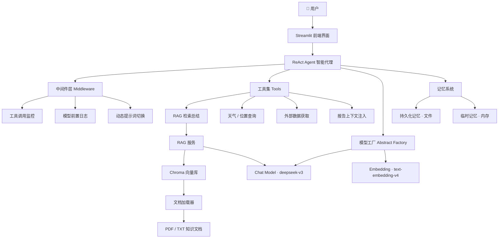
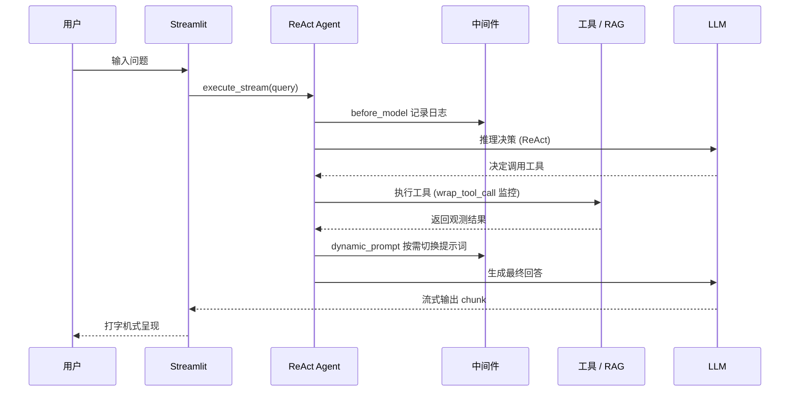

<div align="center">

# 🤖 RAG Agent · ReAct 智能代理系统

### 基于 LangChain 1.x + LangGraph 构建的企业级 RAG 智能客服代理

<p>
  
  
  
  
  
  
</p>

<p>
  
  
</p>

</div>

---

## 📖 项目简介

**RAG Agent** 是一个采用现代 **ReAct（Reasoning + Acting）** 范式的智能代理系统，深度整合了 **检索增强生成（RAG）** 与 **工具调用（Function Calling）** 能力。系统基于 LangChain 1.x 全新的 `create_agent` API 与 **中间件（Middleware）** 机制构建，通过 Streamlit 提供流式对话界面，可广泛应用于**智能客服、企业知识问答、自动化报告生成**等场景。

项目遵循**高内聚、低耦合**的分层架构设计，将模型管理、向量检索、记忆系统、工具链、中间件、配置加载等能力模块化拆分，具备良好的可扩展性与工程化水准。

---

## ✨ 核心特性

| 特性 | 说明 |
| :--- | :--- |
| 🧠 **ReAct 智能代理** | 基于 LangChain 1.x `create_agent`，具备"推理-行动-观察"闭环，自主编排多工具调用 |
| 🔌 **中间件架构** | 使用 `@wrap_tool_call`、`@before_model`、`@dynamic_prompt` 三大钩子，实现工具监控、日志埋点与提示词动态切换 |
| 📚 **RAG 检索增强** | Chroma 向量库 + 语义检索 + LLM 总结，让模型基于私域知识精准作答 |
| 🔄 **动态提示词切换** | 借助 LangGraph `Runtime` 上下文标记，在"报告生成"场景下热切换系统提示词 |
| 🚀 **流式输出** | `agent.stream` + Streamlit `write_stream`，打造逐字打字机式实时响应体验 |
| 💾 **双层记忆系统** | 持久化记忆（文件落盘）+ 临时记忆（内存），支持多会话隔离 |
| 🏭 **抽象工厂模式** | 统一模型创建入口，Chat Model 与 Embedding Model 解耦，易于切换厂商 |
| ♻️ **文档 MD5 去重** | 知识库加载时基于 MD5 指纹去重，避免重复向量化，节省算力与存储 |
| ⚙️ **配置驱动** | YAML 集中管理模型、向量库、提示词、外部数据源等全部配置 |
| 📝 **统一日志系统** | 控制台 + 文件双通道，按日期自动分割，全链路可观测 |

---

## 🏗️ 系统架构



---

## 🧩 请求处理流程



---

## 🧠 技术亮点解析

### 1️⃣ 中间件（Middleware）驱动的横切能力

项目采用 LangChain 1.x 前沿的中间件机制，将**监控、日志、提示词管理**等非业务逻辑从核心链路中剥离，实现 AOP 式的切面增强：

- **`@wrap_tool_call`** — 包裹工具执行，记录调用参数、成功/失败状态，并在特定工具触发时改写 `Runtime` 上下文；
- **`@before_model`** — 模型推理前埋点，输出当前会话消息规模与最新内容；
- **`@dynamic_prompt`** — 每次生成前根据上下文标记**动态返回不同系统提示词**。

### 2️⃣ 基于 Runtime Context 的动态提示词切换

通过一个无副作用的 `fill_context_for_report` 工具作为"信号量"，在中间件中将 `context["report"]` 置为 `True`，从而在**报告生成场景**下无缝切换至专用提示词，实现"一个 Agent、多副面孔"：

```python
@dynamic_prompt
def report_prompt_switch(request: ModelRequest):
    if request.runtime.context.get("report", False):
        return load_report_prompts()   # 报告生成提示词
    return load_system_prompts()       # 常规对话提示词
```

### 3️⃣ 工程化的 RAG 检索管线

- **递归字符分片**（`RecursiveCharacterTextSplitter`）：多级分隔符智能切块，保留语义完整性；
- **MD5 文档指纹去重**：分片计算文件哈希，避免知识库重复入库；
- **检索 + 总结链**：`PromptTemplate | Model | StrOutputParser` 的经典 LCEL 组合。

### 4️⃣ 抽象工厂统一模型管理

以 `BaseModelFactory` 抽象基类规范模型生成接口，业务层无需感知底层厂商差异，切换模型仅需改动工厂实现与 YAML 配置，符合**开闭原则**。

---

## 📁 项目结构

```text
RAG_Agent01/
├── agent/                      # 智能代理核心
│   ├── react_agent.py          # ReAct Agent 定义与流式执行
│   └── tools/
│       ├── agent_tools.py      # 工具集（RAG/天气/位置/外部数据...）
│       └── middleware.py       # 中间件（监控/日志/提示词切换）
├── rag/                        # 检索增强生成
│   ├── rag_service.py          # RAG 总结服务
│   └── vector_store.py         # Chroma 向量库封装 + 文档加载
├── model/
│   └── factory.py              # 抽象工厂：Chat / Embedding 模型
├── memorys/                    # 记忆系统
│   ├── persistent_memory.py    # 持久化记忆（文件）
│   └── temporary_memory.py     # 临时记忆（内存）
├── utils/                      # 通用工具
│   ├── config_handler.py       # YAML 配置加载
│   ├── prompt_loader.py        # 提示词加载
│   ├── file_handler.py         # 文件处理（MD5/PDF/TXT）
│   ├── logger_handler.py       # 统一日志
│   └── path_tool.py            # 路径工具
├── prompts/                    # 提示词模板
│   ├── main_prompt.txt         # 主系统提示词
│   ├── rag_summarize.txt       # RAG 总结提示词
│   └── report_prompt.txt       # 报告生成提示词
├── config/                     # 配置文件
│   ├── rag.yml                 # 模型配置
│   ├── chroma.yml              # 向量库配置
│   ├── agent.yml               # 代理配置
│   └── prompts.yml             # 提示词路径配置
├── data/                       # 知识库数据源（PDF/TXT/CSV）
├── chroma_db/                  # Chroma 持久化目录
├── logs/                       # 运行日志
├── app.py                      # Streamlit 应用入口
├── pyproject.toml              # 依赖与项目元数据（uv）
└── .env                        # 环境变量（API 密钥）
```

---

## 🛠️ 技术栈

| 分类 | 技术选型 |
| :--- | :--- |
| **开发语言** | Python 3.13+ |
| **Agent 框架** | LangChain 1.4+、LangGraph（`create_agent` / Middleware / Runtime） |
| **向量数据库** | Chroma（`langchain-chroma`） |
| **大语言模型** | deepseek-v3（对话）、text-embedding-v4（向量化），经阿里云百炼 OpenAI 兼容模式接入 |
| **前端界面** | Streamlit（流式对话） |
| **文档处理** | PyPDF（PDF 提取）、RecursiveCharacterTextSplitter（分片） |
| **配置管理** | PyYAML、python-dotenv |
| **包管理** | uv（清华镜像源加速） |

---

## 🚀 快速开始

### 1. 克隆项目

```bash
git clone git@github.com:AX3031/RAG_Agent01.git
cd RAG_Agent01
```

### 2. 安装依赖（推荐使用 uv）

```bash
uv sync
```

### 3. 配置环境变量

在项目根目录创建 `.env` 文件：

```dotenv
OPEN_API_KEY=your_dashscope_api_key
BASE_URL_DASHSCOPE=https://dashscope.aliyuncs.com/compatible-mode/v1
```

### 4. 构建知识库（文档向量化入库）

```bash
uv run python -m rag.vector_store
```

### 5. 启动应用

```bash
uv run streamlit run app.py
```

打开浏览器访问 `http://localhost:8501` 即可开始对话 🎉

---

## ⚙️ 配置说明

**模型配置** `config/rag.yml`

```yaml
chat_model_name: deepseek-v3            # 对话模型（需支持工具调用）
embedding_model_name: text-embedding-v4 # 向量化模型
```

**向量库配置** `config/chroma.yml`

```yaml
collection_name: agent       # 集合名称
persist_directory: chroma_db # 持久化目录
k: 3                         # 检索返回的 Top-K 文档数
chunk_size: 200              # 分片大小
chunk_overlap: 20            # 分片重叠
allow_knowledge_file_type: ["txt", "pdf"]  # 支持的知识库文件类型
```

---

## 📌 说明与提示

> ⚠️ Agent 必须使用**支持工具调用（Function Calling）**的模型，例如 `deepseek-v3`、`qwen-max` 等；`deepseek-r1` 为推理模型，不支持工具调用。

> 💡 涉及位置与天气等关联查询时，代理遵循**先获取位置、再查询天气**的串行工具调用逻辑。

---

## 🗺️ Roadmap

### 🧱 结构化输出与工具体系

- [ ] 引入 **Pydantic** 定义工具入参与返回的 Schema，结合 **Tool Strategy** 实现强类型**结构化输出（Structured Output）**，让工具返回结果可被下游稳定消费
- [ ] 完善文件上传界面（`app_file_uploader.py`），支持在线扩充知识库

### 🔌 进阶中间件（Prebuilt Middleware）

- [ ] 集成 `SummarizationMiddleware` —— 对话过长时自动**摘要压缩**历史，控制上下文窗口占用
- [ ] 集成 `HumanInTheLoopMiddleware` —— 高风险工具调用前**暂停并等待人工审批**（批准 / 编辑 / 拒绝）
- [ ] 集成 `TodoListMiddleware` —— 复杂任务的**待办清单化编排**与执行状态跟踪

### 🪝 Hook 钩子装饰器

- [ ] 深化中间件钩子装饰器的应用：`@before_model` / `@after_model` / `@wrap_model_call` / `@wrap_tool_call`，在 Agent「推理-行动」循环的各个节点精细化插入监控、改写与兜底逻辑

### 💾 记忆与向量存储升级

- [ ] 使用 `PostgresStore`（LangGraph Store API）实现**跨会话长期记忆**持久化，原生支持向量语义检索
- [ ] 接入 **Milvus** 构建**远端向量数据库**，替换本地 Chroma，支撑大规模知识库与生产级并发检索

### 📚 RAG 原理与深度优化

- [ ] 补充 RAG 进阶原理与工程实践：`Rerank` **重排序**（召回后精排）、混合检索（Hybrid Search：向量 + 关键词）、召回质量评估与切块策略调优
- [ ] 支持多模型路由与负载均衡，接入更多外部工具（搜索、数据库查询等）

### 🛡️ 工程质量

- [ ] 补充单元测试与集成测试

---

<div align="center">

**如果这个项目对你有帮助，欢迎点个 ⭐ Star 支持一下！**

Built with ❤️ using LangChain & LangGraph

</div>
